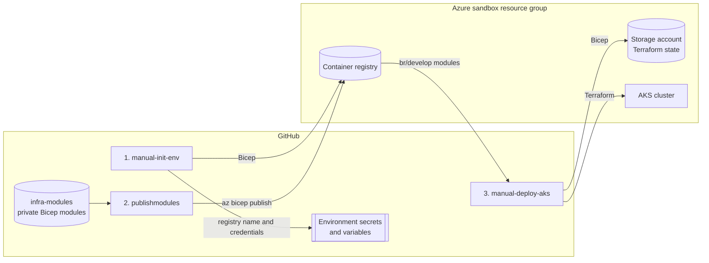

# kubernetes

An AKS platform that builds itself from an empty Azure resource group, designed for [Pluralsight Azure cloud sandboxes](https://help.pluralsight.com/hc/en-us/articles/24392988447636-Azure-cloud-sandbox): they are wiped at the end of every session and forbid role assignments, so nothing can be created by hand and nothing survives.

Three GitHub Actions workflows create a container registry, publish private Bicep modules into it, create Terraform state storage from those modules, and then deploy AKS with Terraform. The only thing that has to exist beforehand is the resource group the sandbox gives you.



## What it builds

| Resource | Built with | Configuration |
| --- | --- | --- |
| Container registry | Bicep, [`bicep/ACR`](bicep/ACR) | Premium SKU, admin user enabled, untagged manifests purged after 15 days |
| Bicep module registry | [`publishmodules`](.github/workflows/publishmodules.yml) | Every module in `infra-modules` pushed to the registry, tagged `<run_id>.<run_number>.<run_attempt>` and `latest` |
| Terraform state storage | Bicep, [`bicep/deployment.bicep`](bicep/deployment.bicep), using the `storage` module from the registry | StorageV2, Standard_LRS, public blob access off, container `aks-terraformstate` |
| AKS cluster | Terraform, [`terraform/AKS`](terraform/AKS) | One `Standard_D2s_v3` Azure Linux node, OIDC issuer and workload identity enabled, Azure Policy add-on, automatic patch upgrades, NodeImage OS upgrades |

Each environment gets its own registry and storage account: names are derived from the environment and a hash of the resource group, so `development` and `production` never share state.

## Sandbox limits and how this repo handles them

| Sandbox limit | What this repo does | What production would do instead |
| --- | --- | --- |
| One pre-created resource group; no new ones | Everything deploys into `AZURE_RESOURCE_GROUP`; the azurerm provider skips resource provider registration | A resource group per layer: shared services, cluster, state |
| No role assignments | ACR admin user for registry access; a SAS token valid for 1 hour for Terraform state | `AcrPull` on the kubelet identity; Entra ID auth to state with Storage Blob Data Contributor |
| No Entra ID objects or federated credentials | Service principal secret in `AZURE_CREDENTIALS`; Kubernetes local accounts | OIDC federation from GitHub Actions; Entra RBAC on AKS with local accounts disabled |
| AKS: at most 3 nodes; 10 vCPUs in total | A single small node | Separate system and user node pools with autoscaling |
| Everything is deleted when the session ends | Registry, modules and state are recreated on every run; state is treated as disposable | A long-lived registry and state account per environment, with resource locks |

## Prerequisites

- **Azure:** a Pluralsight Azure sandbox, or any subscription with a resource group and a service principal that has Contributor on it.
- **Tools on your machine:** [Azure CLI](https://learn.microsoft.com/cli/azure/install-azure-cli) and [GitHub CLI](https://cli.github.com/), signed in.
- **GitHub environments** named `development` and `production`, each holding:

  | Name | Type | Set by | Changes |
  | --- | --- | --- | --- |
  | `AZURE_CREDENTIALS` | secret | you | every sandbox |
  | `AZURE_SUBSCRIPTION_ID` | secret | you | every sandbox |
  | `AZURE_RESOURCE_GROUP` | variable | you | every sandbox |
  | `APP_ID`, `APP_PRIVATE_KEY` | secret | you | once |
  | `ACR_NAME`, `ACR_LOGIN_SERVER` | variable | `manual-init-env` | every run |
  | `ACR_ADMIN_USERNAME`, `ACR_ADMIN_PASSWORD` | secret | `manual-init-env` | every run |

- **A GitHub App** installed on `infra-modules`, `kubernetes` and `devops-labs`. It needs read access to the contents of `infra-modules`, and write access to environment secrets and variables in `kubernetes` and `devops-labs` (`manual-init-env` shares the registry with `devops-labs`).
- **The private `infra-modules` repository**, with each module at `bicep/modules/<name>/main.bicep`. `bicep/deployment.bicep` expects a module named `storage`.

## Deploy into a new sandbox

### 1. Point the environment at the sandbox

Every sandbox comes with a new service principal and subscription. Save the credentials as `creds.json`:

```json
{
  "clientId": "<application-id>",
  "clientSecret": "<secret>",
  "subscriptionId": "<subscription-id>",
  "tenantId": "<tenant-id>"
}
```

Then update the environment, from inside your clone of this repository:

```bash
gh secret set AZURE_CREDENTIALS --env development < creds.json
gh secret set AZURE_SUBSCRIPTION_ID --env development --body "<subscription-id>"
gh variable set AZURE_RESOURCE_GROUP --env development --body "<resource-group>"
rm creds.json
```

### 2. Run the workflows in order

Each workflow needs the previous one to have finished. `gh run watch` asks which run to follow; pick the one that just started.

```bash
gh workflow run manual-init-env.yml -f environment=development
gh run watch

gh workflow run publishmodules.yml -f environment=development
gh run watch

gh workflow run manual-deploy-aks.yml -f environment=development
gh run watch
```

1. **`manual-init-env`** deploys the registry, then writes its name, login server and admin credentials to the GitHub environment.
2. **`publishmodules`** checks out `infra-modules` with a GitHub App token and publishes every module to the registry.
3. **`manual-deploy-aks`** deploys the state storage account from the published `storage` module, creates a SAS token for it, then runs `terraform init`, `plan` and `apply` in `terraform/<environment>`.

### 3. Connect to the cluster

```bash
az aks get-credentials --resource-group "<resource-group>" --name aks-some-other-aks
kubectl get nodes
```

The cluster name is `aks-` plus `name` from `terraform/<environment>/terraform.tfvars`.

## Repository layout

```text
.github/
  actions/bicep-deploy-steps/   composite action: validate, then deploy any Bicep template
  workflows/
    manual-init-env.yml         1. container registry and its credentials
    publishmodules.yml          2. Bicep modules from infra-modules into the registry
    manual-deploy-aks.yml       3. state storage (Bicep), then AKS (Terraform)
bicep/
  ACR/                          registry template and per-environment parameters
  deployment.bicep              Terraform state storage, built from the registry's storage module
  environments/                 per-environment parameters for deployment.bicep
  bicepconfig.json              module alias "develop", pointed at the registry at run time
terraform/
  AKS/                          reusable AKS module
  development/                  root configuration for development
  production/                   root configuration for production
```

## Working locally

Validate Terraform without a backend:

```bash
cd terraform/development
terraform init -backend=false
terraform validate
```

Build the registry template:

```bash
az bicep build --file bicep/ACR/acr.deployment.bicep
```

`bicep/deployment.bicep` restores its `storage` module from the registry. It only builds after `publishmodules` has run and the `develop` alias in `bicepconfig.json` points at your registry; the workflow fills that in at run time.

## Design notes

- **Bicep creates what Terraform needs before it can run.** The registry and the state account exist before `terraform init`, which removes the usual chicken-and-egg problem of storing state for the resources that hold state.
- **Bicep modules are versioned artefacts.** Each publish pushes an immutable run-based tag next to `latest`, so a deployment can pin an exact module version.
- **One way to deploy Bicep.** Every template goes through the same composite action, which validates before it deploys.
- **Credentials are as short-lived as the sandbox allows.** The state SAS token expires after one hour, and registry credentials are read from Azure on every run instead of being copied by hand.

## Roadmap

- [ ] Pull-request CI: `terraform fmt` and `validate`, tflint, Trivy config scan, `bicep lint`, and the plan posted as a PR comment
- [ ] Third-party actions pinned to commit SHAs, kept current by Dependabot
- [ ] Bicep modules pinned to a version instead of `latest`
- [ ] Argo CD on the cluster, with an app-of-apps for workloads
- [ ] Secure-by-default AKS module (Entra RBAC, local accounts off, authorized IP ranges) with sandbox overrides in tfvars
- [ ] Saved `terraform plan` and a required reviewer before production applies

## License

[MIT](LICENSE)
